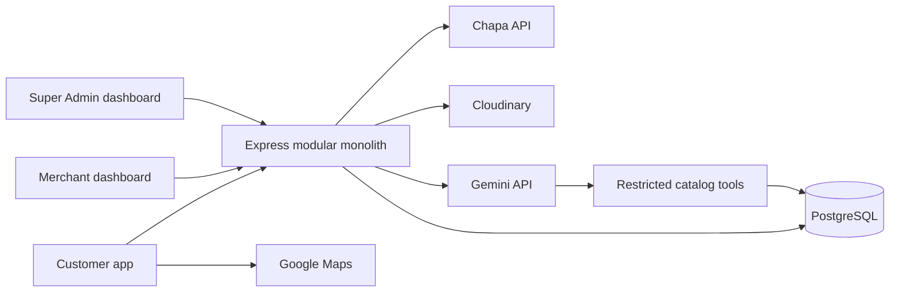

# Team 30 — Location-Based Multi-Vendor Marketplace

Proposed product specification for the Cursor Hackathon in Jimma, Ethiopia.

The application and its specification both live in this repository. Hosted environments are not provisioned here. Payment processing is specified and not connected yet.

## What this product is

The platform connects customers with physical shops. Shop discovery starts on a map. A customer can browse without an account, open a shop from a map marker, search products across shops, and place one checkout that buys from several merchants at once.

The marketplace has four parts:

1. Customer application.
2. Merchant dashboard.
3. Super Admin dashboard.
4. AI shopping assistant, limited to public product discovery.

## Feature summary

- Google Maps landing page with one marker per registered shop, placed at that shop's stored coordinates.
- Shop pages with products, prices, descriptions, and images.
- Cross-shop product search.
- One cart that can hold products from many shops.
- Registration and login before the first order. Registration collects full name, username, and password.
- Checkout with local address name, house number, phone number, delivery or pickup, and Chapa or bank transfer.
- One parent customer order that splits into one merchant sub-order per shop.
- Separate payment status and fulfillment status.
- Chapa payment for the full checkout amount, verified by the backend with Chapa.
- Bank transfer to each merchant's own account, with a receipt uploaded and verified per merchant.
- Merchant product management, order handling, receipt verification, and sales analytics.
- Super Admin control of shops, merchant accounts, categories, and platform oversight, with an audit trail.
- AI assistant that can search and compare the public catalog and cannot read credentials, private profiles, orders, receipts, or tokens.

## Proposed stack

| Layer | Proposed technology |
|---|---|
| Frontend | React, TypeScript, Vite, Tailwind CSS |
| Maps | Google Maps JavaScript API |
| Backend | Node.js, Express, TypeScript |
| Database | PostgreSQL via Prisma |
| Authentication | Short-lived JWT access token plus revocable refresh token |
| Password hashing | Argon2id, with bcrypt as a documented fallback |
| Images | Cloudinary |
| AI | Gemini API, called only through a restricted backend tool layer |
| Payments | Chapa and manual bank transfer |
| Frontend hosting | Vercel |
| Backend hosting | Render |
| Database hosting | Supabase PostgreSQL |

Vite is a toolchain choice. The required frontend stack is React and TypeScript. The backend stays a separate Express service, so a single-page app is enough for the hackathon.

## Architecture in one page

The backend is a modular monolith. Orders, payments, catalog, identity, and the AI assistant are modules in one deployable service and one PostgreSQL database. That is the right shape for a hackathon team: one deployment, one transaction boundary for checkout, and room to split a module out later if a boundary becomes a real bottleneck.

A checkout is atomic. The service locks the selected products, checks stock, writes one parent `orders` row, one `merchant_orders` row per shop, and `order_items` rows that copy the product name and unit price. Merchants can read only their own sub-orders. The customer reads the parent and every sub-order. The Super Admin can read the whole transaction.

The AI assistant never receives a database connection. It can call a fixed set of backend functions. Those functions read a public-catalog query surface and return only public product and shop fields.

## Documentation map

Start here, then read in order:

| Document | Contents |
|---|---|
| [docs/README.md](docs/README.md) | How to use this specification |
| [docs/01-project-overview.md](docs/01-project-overview.md) | Purpose, actors, scope, and glossary |
| [docs/02-functional-requirements.md](docs/02-functional-requirements.md) | Numbered requirements and user-visible behavior |
| [docs/03-system-architecture.md](docs/03-system-architecture.md) | Modular monolith, non-functional requirements, open decisions |
| [docs/04-database-design.md](docs/04-database-design.md) | Schema, integrity rules, indexes, Prisma proposal |
| [docs/05-api-specification.md](docs/05-api-specification.md) | REST contract |
| [docs/06-authentication-and-security.md](docs/06-authentication-and-security.md) | Access control and threat model |
| [docs/07-order-and-payment-workflows.md](docs/07-order-and-payment-workflows.md) | Parent/sub-order processing, Chapa, bank transfer |
| [docs/08-google-maps-integration.md](docs/08-google-maps-integration.md) | Coordinates, markers, clustering, key restrictions |
| [docs/09-ai-shopping-assistant.md](docs/09-ai-shopping-assistant.md) | Tool-based assistant and catalog isolation |
| [docs/10-analytics-and-reporting.md](docs/10-analytics-and-reporting.md) | Views, sales metrics, and who may read them |
| [docs/11-testing-strategy.md](docs/11-testing-strategy.md) | Test layers and required edge cases |
| [docs/12-deployment-and-infrastructure.md](docs/12-deployment-and-infrastructure.md) | Proposed hosting, configuration, backup |
| [docs/13-development-roadmap.md](docs/13-development-roadmap.md) | Phased delivery plan |

Diagram sources live in [docs/diagrams](docs/diagrams).

## Status

| Item | Status |
|---|---|
| Product and technical specification | Written |
| Application source | Phase 1 marketplace and the shopping assistant |
| Database migration | Created |
| Hosted environments | Not provisioned in this repository |
| Payments | Specified, not connected |
| Maps | Used when `VITE_GOOGLE_MAPS_API_KEY` is set |
| Shopping assistant | Backend Gemini tools. Set `GEMINI_API_KEY` in the gitignored root `.env` (see `.env.example` and [docs/09-ai-shopping-assistant.md](docs/09-ai-shopping-assistant.md)). Do not add a `VITE_` variable for that key. |

Open decisions are collected in [docs/03-system-architecture.md](docs/03-system-architecture.md#unresolved-architectural-decisions). The highest-impact one is that Chapa's payment initialization commonly requires an email address, while customer registration does not collect email.

`four_person_team_workflow.md` assigns owners for a four-person build. Its earlier status names and JSON examples are not the contract. The numbered files in `docs/` are.
